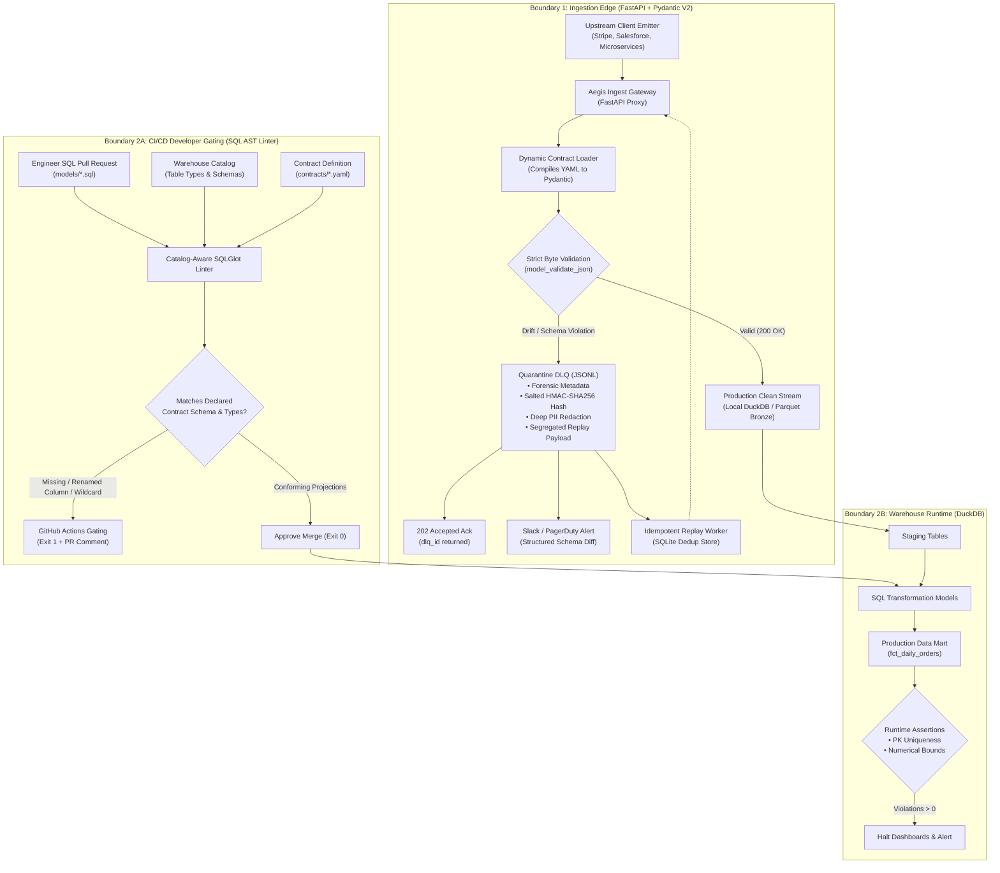

# AegisContract: Dual-Boundary Data Contract & SQL AST Verification Engine

[](https://github.com/HarK-github/aegis-contract/actions)
[](https://www.python.org/downloads/)
[](https://docs.pydantic.dev/latest/)
[](https://github.com/tobymao/sqlglot)
[](https://duckdb.org/)

> **Core Architectural Principle**: *Enforce strict contract boundaries at the edge; statically verify SQL transformations before warehouse execution.*

---

## 1. Executive Summary: The Dual-Boundary Problem

Data platforms break primarily across two unmonitored boundaries:

```
┌────────────────────────────────────────────────────────────────────────────────────────────────────────┐
│                                   AEGISCONTRACT DUAL-BOUNDARY PLATFORM                                 │
├──────────────────────────────────────────┬─────────────────────────────────────────────────────────────┤
│      BOUNDARY 1: THE INGESTION EDGE      │            BOUNDARY 2: THE WAREHOUSE ENGINE                 │
│     (JSON / Protobuf Network Proxy)      │              (Catalog-Qualified SQL AST)                    │
├──────────────────────────────────────────┼─────────────────────────────────────────────────────────────┤
│ • Dynamic YAML -> Pydantic V2 Compiler   │ • Static SQL AST Analysis via `sqlglot`                     │
│ • Byte-level Strict Parsing (No Auto-Cast│ • Pre-compile dbt Jinja Mocking (Regex Approximation)       │
│ • HMAC Webhook Signature Verification    │ • Wildcard Guard (Prohibits `SELECT *` & `SELECT t.*`)      │
│ • Quarantine DLQ with Forensic Metadata  │ • Output Projection & Inferred Type Verification            │
│ • Salted HMAC Hash & Deep PII Redaction  │ • Dual-Perspective SemVer Diff Engine (Producer & Consumer) │
│ • 202 Accepted Ack & Idempotent Replay   │ • In-Warehouse Runtime Assertions (DuckDB Native Cursors)   │
└──────────────────────────────────────────┴─────────────────────────────────────────────────────────────┘
```

1. **The Ingestion Boundary (Network Edge)**: Client dev teams and third-party webhooks change payload shapes unannounced (e.g. integer IDs becoming strings, renamed fields, missing required attributes). Ingestion pipelines crash or downstream warehouse tables fill with silent `NULL`s.
2. **The Warehouse Boundary (SQL Transforms)**: Analytics engineers modify transformation models (CTEs, joins, window functions) that inadvertently drop or alter columns that downstream executive dashboards or ML feature stores depend on.

---

## 2. End-to-End System Architecture



---

## 3. Core Capabilities & Realistic Engineering Trade-offs

### A. Dynamic Contract Compilation (Zero Code Duplication)
Contracts are authoritatively defined in YAML (`contracts/finance/orders_v1.yaml`). AegisContract compiles the schema into strict Pydantic V2 models at startup using `create_model`:
* **Raw Byte Strict Validation**: Uses `model_validate_json(raw_bytes)`, allowing valid ISO8601 strings and UUIDs to be parsed while strictly rejecting silent type coercions (e.g. `"123"` into integer `123`).
* **Rogue Field Protection**: Sets `extra="forbid"` to prevent unannounced field pollution.

### B. Forensic DLQ & Segregated Replay
* **Forensic Metadata**: Quarantined records capture exact validation errors (`loc`, `type`, `msg`), client IP, UTC timestamp, and a salted HMAC-SHA256 payload hash (preventing dictionary/rainbow table brute-forcing on low-entropy payloads).
* **Deep PII Redaction vs. Replay Paradox Resolved**: 
  - `sanitized_payload`: Sensitive attributes (`password`, `card_number`, `token`, `secret`, `ssn`) are recursively masked for human operator inspection and telemetry alerts.
  - `replay_payload_enc`: Encrypted raw bytes (Fernet) are preserved in an isolated machine-replay attribute so historical backfills heal authentic data rather than inserting asterisks into downstream tables.
* **Scope Note on PII**: Key-pattern masking redacts structured sensitive fields. Unstructured free-text PII (e.g. credit card numbers inside free-text user comments) requires external ML NER services and is outside the scope of this edge proxy.

### C. Catalog-Aware SQL AST Linter (`sqlglot`)
* **Wildcard Guard**: Detects and blocks raw wildcards (`SELECT *`) and qualified wildcards (`SELECT t.*`, `SELECT schema.t.*`) *before* AST qualification can expand them.
* **dbt Jinja Approximation**: Uses regex mocking for `{{ ref(...) }}`, `{{ source(...) }}`, `{{ this }}`, and control blocks (``, ``). Documented explicitly as a static approximation that covers common models without requiring a full dbt compiler runtime.
* **Type Inference**: Qualifies CTE projections against base warehouse schemas using `sqlglot.optimizer.qualify` and `annotate_types`, flagging type mismatches (e.g. `FLOAT64` vs expected `NUMERIC`).

### D. Dual-Perspective Structural Contract Diff Engine (`diff_engine.py`)
Classifies contract version changes across two distinct vectors:
* **Producer SemVer**: What emitters are allowed to send (`MAJOR` = breaking, `MINOR` = additive, `PATCH` = metadata).
* **Consumer Blast Radius**: Evaluates whether producer additions (e.g. newly optional fields or expanded enum variants) break downstream ETL transforms, SQL queries, or ML models expecting non-null columns or exhaustive match clauses.

### E. In-Warehouse Runtime Assertions
Analytical databases often do not enforce primary key constraints at storage time. AegisContract executes native DuckDB runtime assertions (`order_id_unique` and `gross_revenue_positive`) directly against target tables without heavyweight dependencies.

---

## 4. Empirical Benchmark Scorecard (5-Run Statistical Median)

Evaluated against a synthetic 5,000-event benchmark stream featuring **472 injected schema-drift events across 4 classes** (type drift, field rename, null violation, range violation).

**Hardware Environment**: Linux 7.0.0-43-generic, x86_64, 16 vCPUs.

```
=================================================================
               AEGISCONTRACT BENCHMARK SCORECARD                 
=================================================================
• Total Events Processed:        5,000
• Clean Accepted:                4,528
• Quarantined Drift:             472
• False Positives / Negatives:   0 / 0
-----------------------------------------------------------------
📊 Profile 1: Core Pydantic V2 In-Memory Validation (5-Run Median):
   - p50 (Median Latency):       6.60 µs
   - Mean Latency:               7.20 µs
   - Core Processing Speed:      ~69,800 events/sec (Single Core)
-----------------------------------------------------------------
🌐 Profile 2: In-Process ASGI Gateway + DLQ Disk I/O (5-Run Median):
   - p50 (Median Latency):       3.08 ms
   - Mean Latency:               3.15 ms
   - In-Process Throughput:      ~290 requests/sec (Single Thread)
=================================================================
```

> **Scope Note on Metrics**: Structural precision and recall hold for schema violations defined in the contract. Schema validation cannot detect semantic unit shifts (e.g. cents sent as whole dollars), lowercase `"usd"`, or statistical distribution drift.

---

## 5. Quickstart & Local Reproduction

The entire platform runs locally in a clean virtual environment with zero cloud credentials.

### 1. Installation
```bash
git clone https://github.com/HarK-github/aegis-contract.git
cd aegis-contract
python -m venv .venv && source .venv/bin/activate
pip install -r requirements.txt
```

### 2. Run the Test Suite (31 Tests Passing, 0 Warnings)
```bash
pytest -v
```

### 3. Verify Real Source Mutation Protection
```bash
# Temporarily mutate source code to test test coverage
sed -i 's/extra="forbid"/extra="ignore"/' src/edge/contract_loader.py
pytest -q tests/test_contract_loader.py  # MUST FAIL with AssertionError
git checkout src/edge/contract_loader.py  # Restore clean source
```

---

## 7. Author & License

- **Author**: Harshit Kandpal ([@HarK-github](https://github.com/HarK-github))
- **License**: Apache-2.0
